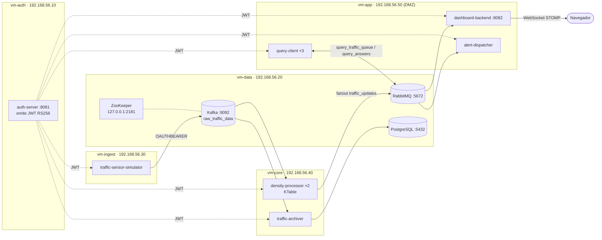

# SmartTraffic · Zona Cero (Zero Trust)

**Monitoreo de tráfico en tiempo real con Java 17, Spring Boot, Kafka, RabbitMQ y PostgreSQL, desplegado en 5 máquinas virtuales con seguridad de confianza cero.**

Proyecto final integrador de tres materias: **Sistemas Operativos**, **Sistemas Distribuidos** y **Programación Orientada a Objetos**.

**Grupo 1 · 6A** · [Daniel Pérez](https://github.com/Whatfck) · [Santiago Urbina](https://github.com/Santiago2509)

---

## Contenido

1. [Enunciado](#1-enunciado)
2. [Qué construimos](#2-qué-construimos)
3. [Arquitectura: 5 zonas de seguridad](#3-arquitectura-5-zonas-de-seguridad)
4. [Flujo de datos](#4-flujo-de-datos)
5. [Decisiones de diseño](#5-decisiones-de-diseño)
6. [Seguridad Zero Trust](#6-seguridad-zero-trust)
7. [Programación orientada a objetos](#7-programación-orientada-a-objetos)
8. [Persistencia con PostgreSQL](#8-persistencia-con-postgresql)
9. [Contenedores y recursos](#9-contenedores-y-recursos)
10. [Pruebas](#10-pruebas)
11. [Estructura del repositorio](#11-estructura-del-repositorio)
12. [Cómo ejecutarlo](#12-cómo-ejecutarlo)
13. [Cumplimiento del enunciado](#13-cumplimiento-del-enunciado)

---

## 1. Enunciado

**Ejercicio 11 · Reto de infraestructura: SmartTraffic – Zona Cero (Zero Trust) con Java, Spring Boot, POO y persistencia.**

Construir un sistema de monitoreo de tráfico basado en microservicios y desplegarlo en un entorno de red hostil:

- **Mensajería híbrida:** Kafka como registro de eventos para la ingesta y RabbitMQ para distribuir el estado y atender consultas asíncronas. Se debe justificar el uso de ambos.
- **Procesamiento de flujos:** un consumidor *stateful* de Kafka (KTable) y la replicación del estado por RabbitMQ.
- **Infraestructura como código:** 5 máquinas virtuales aprovisionadas automáticamente con Vagrant o Ansible.
- **Red de confianza cero:** política *default deny* con **nftables** en cada VM; solo el tráfico esencial entre IPs y puertos autorizados.
- **Autenticación servicio a servicio (S2S):** un Auth Server que emite **JWT firmados**. Kafka (SASL/OAUTHBEARER) y RabbitMQ (`rabbitmq_auth_backend_oauth2`) validan el token en cada conexión, sin acceso anónimo.
- **POO avanzada en Java 17+:** patrones **Strategy**, **State** y **Observer**, **DIP** con inyección por constructor, **modelo de dominio rico** (no anémico) y `record` inmutables con validación **fail-fast**.
- **Pruebas unitarias aisladas:** dominio puro con patrón AAA y servicios con **Mockito** (`@Mock`, `@InjectMocks`, `verify`).
- **Persistencia:** histórico inmutable de lecturas y auditoría en **PostgreSQL** con Spring Data JPA, respetando el encapsulamiento.
- **Contenedores:** Dockerfiles **multietapa** (Maven → JRE Alpine con usuario sin privilegios), límites de CPU y RAM sincronizados con la JVM y réplicas con `deploy.replicas`. Docker Compose corre **dentro de cada VM**, no como un orquestador central.
- **Datos:** generados de forma **aleatoria**.

**Entregable:** este repositorio. **Evaluación:** 15 minutos para mostrar la aplicación funcionando y explicar el código, la arquitectura y las decisiones de diseño.

<details>
<summary>Ver el enunciado original completo</summary>

### Resumen del proyecto
Este proyecto es una fusión del sistema de monitoreo SmartTraffic con un desafío de infraestructura de "confianza cero" (Zero Trust). El objetivo ya no es solo construir los microservicios, sino desplegarlos en un entorno de red hostil y realista compuesto por múltiples Máquinas Virtuales (VMs). El flujo de datos de SmartTraffic (Kafka para ingesta, RabbitMQ para distribución y consultas) se mantiene, pero cada componente (broker, microservicio, base de datos) será aislado en su propia VM o zona de seguridad. El reto es automatizar el despliegue, implementar autenticación de servicio a servicio (S2S) mediante tokens (JWT), bloquear toda la comunicación no autorizada usando reglas estrictas de nftables, e incorporar el ecosistema robusto de Java 17+ y Spring Boot con buenas prácticas de diseño orientado a objetos, persistencia relacional en PostgreSQL, pruebas unitarias automatizadas y control estricto de recursos por contenedor. Docker Compose ya no se usará como un único orquestador central que enlaza todo en un host plano; en su lugar, Docker y Compose se utilizarán para compilar, ejecutar y gobernar los servicios localmente dentro de cada una de las VMs aprovisionadas.

### Arquitectura exigida
- **vm-auth (Autoridad):** `auth_server`, única entidad que firma y emite JWT.
- **vm-data (Datos y persistencia):** `kafka` (+ `zookeeper`), `rabbitmq` y `postgres-db` con volúmenes persistentes.
- **vm-ingest (Ingesta, borde):** `traffic_sensor_simulator`, con cuotas reducidas de CPU y memoria.
- **vm-core (Procesamiento):** `traffic_density_processor` (stateful) y `traffic_archiver` (persistencia).
- **vm-app (Aplicación, DMZ):** `user_dashboard_backend`, `alert_dispatcher` y `query_client` (réplicas). Única zona expuesta al exterior.

### Microservicios exigidos
0. **auth_server:** endpoint `/token`; recibe `client_id` y `client_secret` y emite JWT firmados con roles y permisos.
1. **traffic_sensor_simulator:** lecturas en un `record` fail-fast; pide su JWT y publica en `raw_traffic_data` con SASL/OAUTHBEARER.
2. **traffic_density_processor:** agregado `ZoneTrafficAggregate` en memoria con Strategy (densidad) y State (congestión); publica el estado en RabbitMQ autenticado con OAuth2.
3. **traffic_archiver:** guarda lecturas y eventos en PostgreSQL con entidades JPA y repositorios desacoplados.
4. **user_dashboard_backend:** consume el Fanout, mapea a DTOs inmutables y emite por WebSocket.
5. **alert_dispatcher:** réplica local del estado, Observer para alertas, excepciones de dominio para zonas inexistentes y respuestas por Topic Exchange.
6. **query_client:** varias réplicas que publican consultas y reciben respuestas por una cola exclusiva con routing key.
7. **dashboard.html:** cliente web conectado al WebSocket de vm-app.

### Políticas nftables exigidas
`policy drop` en input y output de cada VM. vm-auth acepta su puerto solo desde vm-ingest, vm-core y vm-app. vm-data acepta 9092 desde vm-ingest y vm-core, 5672 desde vm-core y vm-app, y 5432 solo desde vm-core. vm-app expone únicamente el WebSocket del dashboard.

</details>

---

## 2. Qué construimos

SmartTraffic detecta en tiempo real qué zonas de una ciudad están **despejadas, moderadas o congestionadas**:

1. Un **sensor** simulado genera cada segundo lecturas aleatorias (vehículos y velocidad media) para 5 zonas: norte, centro, sur, este y oeste.
2. Las lecturas entran a **Kafka**.
3. El **processor** calcula la densidad y el estado de cada zona con una **KTable**; el **archiver** guarda cada lectura en **PostgreSQL**.
4. **RabbitMQ** reparte el estado al **dashboard**, a las **alertas** y a las **consultas de rutas**.
5. El **dashboard** se actualiza en vivo por **WebSocket** en `http://192.168.56.50:8082/dashboard.html`.

Todo corre en **5 VMs** y cada conexión debe pasar **dos controles**: el firewall (nftables) y un token JWT válido.

| | |
|---|---|
| Lenguaje y framework | Java 17 · Spring Boot 3.4.4 · Maven multimódulo |
| Mensajería | Apache Kafka 7.7.1 (Confluent) + Kafka Streams · RabbitMQ 4.0 |
| Base de datos | PostgreSQL 16 · Spring Data JPA / Hibernate |
| Seguridad | JWT RS256 (jjwt) · Kafka SASL/OAUTHBEARER · RabbitMQ OAuth2 · nftables |
| Infraestructura | Vagrant + VirtualBox (Ubuntu 22.04) · Docker + Docker Compose · Ansible (alternativa) |
| Pruebas | JUnit 5 · Mockito · Kafka Streams TopologyTestDriver |

---

## 3. Arquitectura: 5 zonas de seguridad



| VM | IP | Contenedores | RAM de la VM |
|---|---|---|---|
| **vm-auth** | 192.168.56.10 | `auth-server` | 1 GB |
| **vm-data** | 192.168.56.20 | `zookeeper`, `kafka`, `rabbitmq`, `postgres-db` | 3 GB |
| **vm-ingest** | 192.168.56.30 | `traffic-sensor-simulator` | 1 GB |
| **vm-core** | 192.168.56.40 | `traffic-density-processor` ×2, `traffic-archiver` | 1.75 GB |
| **vm-app** | 192.168.56.50 | `user-dashboard-backend`, `alert-dispatcher`, `query-client` ×3 | 1.75 GB |

Cada VM tiene **dos adaptadores de red**: una red privada host-only compartida (`192.168.56.0/24`) por donde conversan los servicios, y una NAT propia (`10.0.2.x`) que solo se usa para instalar paquetes y para el SSH de Vagrant. Los contenedores usan `network_mode: host`, así que el firewall de la VM los controla directamente.

**Ninguna VM llama directamente a otra de negocio:** todo pasa por vm-data. El sensor deja la lectura en Kafka y vm-core la recoge; ni siquiera se conocen.

---

## 4. Flujo de datos

| Fase | Qué pasa | Dónde está en el código |
|---|---|---|
| **0 · Arranque** | Vagrant crea las VMs; `provision.sh` instala Docker y nftables, genera los secretos, construye las imágenes, levanta el compose de la VM y aplica el firewall | `Vagrantfile` · `infra/scripts/provision.sh` |
| **1 · Identidad** | Cada servicio pide su JWT a vm-auth con `client_credentials` | `auth-server/.../TokenIssuer.java` |
| **2 · Ingesta** | El sensor publica cada segundo en `raw_traffic_data` con la zona como clave | `traffic-sensor-simulator/.../KafkaTrafficReadingPublisher.java` |
| **3 · Persistencia** | El archiver consume y guarda la lectura y su auditoría en una transacción | `traffic-archiver/.../ArchivingService.java` |
| **4 · Procesamiento** | El processor agrupa por zona en una KTable y aplica Strategy y State | `traffic-density-processor/.../TrafficTopology.java` |
| **5 · Distribución** | El estado se publica en el fanout `traffic_updates` | `traffic-density-processor/.../RabbitTrafficStatePublisher.java` |
| **6 · Réplica y alertas** | El alert-dispatcher actualiza su réplica local y el Observer lanza la alerta | `alert-dispatcher/.../CongestionAlertNotifier.java` |
| **7 · Dashboard** | El backend reenvía el estado por WebSocket (`/ws`, `/topic/traffic`) | `user-dashboard-backend/.../WebSocketDashboardBroadcaster.java` |
| **8 · Consultas** | Los query-client preguntan por `query_traffic_queue`; la respuesta vuelve solo a quien preguntó por el topic `query_answers` (`query.<clientId>`) | `query-client/.../QueryClientConfiguration.java` · `alert-dispatcher/.../RouteQueryService.java` |

---

## 5. Decisiones de diseño

### ¿Por qué Kafka **y** RabbitMQ?

La entrada y la salida necesitan cosas distintas, así que cada broker hace lo que mejor sabe.

| | Kafka (entrada) | RabbitMQ (salida) |
|---|---|---|
| Qué es | Un registro de eventos (log) persistente | Un broker que enruta mensajes con exchanges |
| Por qué aquí | Las lecturas llegan sin parar, deben quedar **en orden** y **dos servicios** (processor y archiver) leen las mismas. Kafka no borra al leer y permite reconstruir la KTable desde su changelog | El estado se **difunde a varios** (fanout) y las consultas necesitan **pregunta-respuesta dirigida** a un cliente (cola + topic con routing key) |
| Cómo lo usamos | Topic `raw_traffic_data`, 3 particiones, clave = zona | Fanout `traffic_updates`, cola durable `query_traffic_queue`, topic `query_answers` |

Solo con RabbitMQ, el processor y el archiver se quitarían los mensajes uno al otro. Solo con Kafka, responder a un único cliente sería complicado.

### ¿Por qué 5 VMs y no 5 contenedores en un solo host?

Cada VM es una **zona de seguridad** con su propio kernel y su propio firewall. Si alguien compromete vm-app, que es lo único expuesto, queda encerrado en esa VM y no puede llegar a la base de datos.

### ¿Por qué Vagrant?

Es **infraestructura como código**: toda la infraestructura está en el repositorio y se crea igual en cualquier PC con `vagrant up`. Se puede destruir y volver a crear idéntica. `infra/ansible/` ofrece la misma provisión con Ansible.

### Otras decisiones

- **Clave de partición = zona:** todas las lecturas de una zona caen en la misma partición y en orden, así la KTable agrupa sin reparticionar.
- **2 réplicas del processor:** Kafka reparte las 3 particiones entre ellas y cada réplica maneja sus zonas.
- **Histéresis en los estados:** se sube a moderada en 0.35 y a congestionada en 0.70, pero se baja en 0.55 y 0.25, para que una zona en el borde no cambie de color a cada segundo.
- **Variables de entorno para toda la configuración:** el mismo jar corre en cualquier entorno; IPs y secretos llegan desde el compose.

---

## 6. Seguridad Zero Trust

*"Nunca confiar, siempre verificar":* estar dentro de la red no da permiso. Cada conexión pasa por dos controles.

### Primer control: firewall nftables

Cada VM tiene su archivo en `infra/nftables/` con **`policy drop`** en `input`, `forward` y `output`. Solo existen reglas exactas por IP de origen y puerto TCP, y lo descartado se registra con el prefijo `ST-DROP`.

| VM | Acepta | Puede iniciar conexiones hacia |
|---|---|---|
| vm-auth | 8081 desde .30, .40, .50 y desde vm-data (JWKS) | — |
| vm-data | 9092 desde .30 y .40 · 5672 desde .40 y .50 · 5432 solo desde .40 | vm-auth:8081 (llave pública) |
| vm-ingest | — | vm-auth:8081 · vm-data:9092 |
| vm-core | — | vm-auth:8081 · vm-data:9092, 5672, 5432 |
| vm-app | 8082 desde el exterior (dashboard) | vm-auth:8081 · vm-data:5672 |

ZooKeeper (2181) y el listener interno de Kafka (29092) escuchan solo en `127.0.0.1`. El SSH solo se acepta desde el anfitrión de Vagrant (`10.0.2.2`).

### Segundo control: JWT por servicio

1. Cada servicio pide un token a `POST /token` en vm-auth con su `client_id` y su `client_secret`.
2. vm-auth lo firma con **RS256**, con audiencia, scopes y roles propios de ese servicio, y 15 minutos de vida.
3. El servicio lo presenta al conectarse: a **Kafka** con SASL/OAUTHBEARER y a **RabbitMQ** con el plugin OAuth2.
4. El broker verifica la firma con la llave pública (`/.well-known/jwks.json`), el emisor, la audiencia y la vigencia. Los clientes renuevan el token antes de que venza y Kafka exige re-autenticarse cada 5 minutos.

RabbitMQ **no tiene usuarios**: su único backend de autenticación es OAuth2, y los scopes del token limitan qué exchanges, colas y routing keys puede usar cada servicio.

| Pieza | Archivo |
|---|---|
| Emisión del JWT | `auth-server/src/main/java/com/smarttraffic/auth/TokenIssuer.java` |
| Llave pública (JWKS) | `auth-server/src/main/java/com/smarttraffic/auth/JwksController.java` |
| Kafka valida JWT | `infra/compose/docker-compose.vm-data.yml` (servicio `kafka`) |
| RabbitMQ solo OAuth2 | `infra/rabbitmq/20-smarttraffic.conf` |
| Clientes RabbitMQ con JWT | `smarttraffic-security/.../RabbitOAuth2AutoConfiguration.java` |
| Clientes Kafka con JWT | `application.yml` de sensor, processor y archiver (`sasl.mechanism: OAUTHBEARER`) |

### Secretos

`provision.sh` genera en el primer arranque, con `openssl rand`, la contraseña de PostgreSQL y un secreto distinto por servicio en `.secrets/smarttraffic.env`. Esa carpeta está en `.gitignore` y `.dockerignore`: **el repositorio no contiene ninguna credencial** y cada instalación genera las suyas. La llave privada que firma los JWT vive solo en el volumen de vm-auth.

---

## 7. Programación orientada a objetos

El dominio está en el módulo **`smarttraffic-domain`**, en Java puro, sin Spring, sin Kafka y sin base de datos.

### Modelo de dominio rico: `ZoneTrafficAggregate`

`smarttraffic-domain/src/main/java/com/smarttraffic/domain/ZoneTrafficAggregate.java`

Un modelo **anémico** solo tiene getters y setters, y la regla de negocio queda afuera. El nuestro es **rico**: campos privados, **sin setters**, y un único método de negocio que protege sus invariantes:

```java
public ZoneTrafficSnapshot record(TrafficReading reading) {
    if (!reading.belongsTo(zoneId.value())) throw new IllegalArgumentException(...); // invariante
    density = TrafficDensity.clamped(strategy.calculate(reading));                   // Strategy
    state = state.next(density);                                                      // State
    readings++;
    if (previous != current) observers.forEach(o -> o.onCongestionChanged(event));    // Observer
    return snapshot();
}
```

### Patrones

| Patrón | Para qué | Clases |
|---|---|---|
| **Strategy** | Cambiar el algoritmo de densidad sin tocar el consumidor | `TrafficDensityStrategy` → `VehicleDensityStrategy`, `SpeedDensityStrategy`, `WeightedDensityStrategy`. Se elige con la variable `DENSITY_STRATEGY` en `DensityStrategyConfiguration` |
| **State** | Transiciones DESPEJADA ↔ MODERADA ↔ CONGESTIONADA sin `if-else` ni `switch` anidados | `TrafficZoneState`, `AbstractZoneState`, `ClearZoneState`, `ModerateZoneState`, `CongestedZoneState`, `TransitionRule`, `StateCatalog`, `CongestionThresholds` |
| **Observer** | Avisar los cambios de congestión de forma desacoplada | `CongestionObserver`, `CongestionChangedEvent`; sujetos `ZoneTrafficAggregate` y `TrafficStateReplica`; observador `CongestionAlertNotifier` |
| **Repository** | Aislar la persistencia | `TrafficReadingRepository`, `AuditEventRepository` |
| **Puertos y adaptadores (DIP)** | El dominio depende de interfaces; Kafka, RabbitMQ y JPA son adaptadores | Puertos: `TrafficReadingPublisher`, `TrafficStatePublisher`, `ReadingArchive`, `AuditTrail`, `DashboardBroadcaster`, `RouteAnswerPublisher`, `RouteQuerySender`, `ClientRegistry`, `SigningKeyProvider` |

### Inmutabilidad y fail-fast

Los contratos, identificadores y DTOs son `record` que se validan en su constructor compacto, así que **no existen objetos inválidos**: `TrafficReading` rechaza vehículos o velocidades negativas y fechas nulas; también `ZoneTrafficSnapshot`, `RouteQuery`, `RouteEvaluation`, `ZoneId`, `TrafficDensity`, `ZoneStatusView`, `ClientIdentity` y `RegisteredClient`.

Toda la inyección de dependencias es **por constructor**; no hay `@Autowired` en campos.

---

## 8. Persistencia con PostgreSQL

PostgreSQL 16 corre en vm-data con el volumen `postgres-data`, y **solo vm-core** puede llegar al puerto 5432.

El servicio `traffic-archiver` (vm-core) guarda cada lectura:

```
Kafka ─► KafkaReadingListener ─► ArchivingService (@Transactional)
      ─► ReadingArchive (puerto) ─► JpaReadingArchive (adaptador) ─► TrafficReadingRepository ─► PostgreSQL
```

| Tabla | Entidad | Contenido |
|---|---|---|
| `traffic_readings` | `TrafficReadingEntity` | zona, vehículos, velocidad media, fecha de observación y de archivo. Índice por zona y fecha |
| `audit_events` | `AuditEventEntity` | lecturas archivadas y rechazadas, con el servicio que las registró |

Las entidades son **`@Immutable`** con columnas `updatable = false`: el histórico solo crece y nunca se modifica. No tienen setters públicos; se crean con `from(...)` u `of(...)` y se convierten al dominio con `toDomain()`. La conexión está en `traffic-archiver/src/main/resources/application.yml`; la contraseña llega por la variable `POSTGRES_PASSWORD`.

---

## 9. Contenedores y recursos

### Dockerfile multietapa (uno por microservicio, 7 en total)

| Etapa | Imagen | Qué hace |
|---|---|---|
| 1 · Compilación | `maven:3.9.6-eclipse-temurin-17-alpine` | Copia primero los `pom.xml` y ejecuta `mvn dependency:go-offline -B` (capa en caché); luego compila con `mvn clean package -DskipTests` |
| 2 · Ejecución | `eclipse-temurin:17-jre-alpine` | Solo copia el `.jar`, corre como `appuser:appgroup` y usa `JAVA_OPTS="-XX:+UseContainerSupport -XX:MaxRAMPercentage=75.0 -XX:+ExitOnOutOfMemoryError"` |

### Docker Compose (uno por VM, 5 en total, en `infra/compose/`)

Cada compose define las variables de entorno de sus servicios (IPs de vm-auth y vm-data, secretos), los límites `deploy.resources.limits` de CPU y RAM de cada contenedor (incluido `postgres-db`) y las réplicas: `traffic-density-processor` ×2 y `query-client` ×3. Kafka, ZooKeeper, RabbitMQ y PostgreSQL usan imágenes oficiales.

---

## 10. Pruebas

**49 pruebas** en 12 clases, todas sin infraestructura real:

| Tipo | Qué validan | Clases |
|---|---|---|
| Dominio puro (AAA, sin Spring) | Invariantes del agregado, transiciones del State con histéresis, records fail-fast, estrategias intercambiables | `smarttraffic-domain/src/test/...` |
| Servicios con Mockito | Que una lectura se persiste y se publica **exactamente una vez** (`verify`), consultas de rutas, emisión de tokens | `TrafficProcessingServiceTest`, `ArchivingServiceTest`, `TrafficSensorSimulatorTest`, `RouteQueryServiceTest`, `DashboardServiceTest`, `RouteQueryClientTest`, `TokenIssuerTest` |
| Topología Kafka Streams | La KTable acumula el estado por zona y publica cada cambio | `TrafficTopologyTest` (TopologyTestDriver) |

```bash
mvn test
```

> Con JDK 21 o superior, Mockito necesita `mvn test "-Dnet.bytebuddy.experimental=true"`.

---

## 11. Estructura del repositorio

```
smarttraffic-zero-trust/
├── pom.xml                         # proyecto Maven multimódulo (Java 17, Spring Boot 3.4.4)
├── Vagrantfile                     # las 5 VMs: IP, RAM, CPU y provisión
│
├── smarttraffic-domain/            # POO pura: agregado, State, Strategy, Observer, records
├── smarttraffic-security/          # autoconfiguración compartida: RabbitMQ con JWT
│
├── auth-server/                    # vm-auth   · /token, JWKS, firma RS256
├── traffic-sensor-simulator/       # vm-ingest · genera lecturas y publica en Kafka
├── traffic-density-processor/      # vm-core   · Kafka Streams (KTable) → RabbitMQ
├── traffic-archiver/               # vm-core   · Kafka → PostgreSQL (JPA)
├── user-dashboard-backend/         # vm-app    · RabbitMQ → WebSocket + dashboard.html
├── alert-dispatcher/               # vm-app    · réplica de estado, alertas, respuestas
├── query-client/                   # vm-app    · consultas asíncronas de rutas (×3)
│
└── infra/
    ├── compose/                    # docker-compose.vm-{auth,data,ingest,core,app}.yml
    ├── nftables/                   # vm-{auth,data,ingest,core,app}.nft (default deny)
    ├── rabbitmq/                   # 20-smarttraffic.conf y plugins (solo OAuth2)
    ├── scripts/provision.sh        # provisión de cada VM
    └── ansible/                    # alternativa de provisión con Ansible
```

Cada microservicio sigue la misma forma: `src/main/java/com/smarttraffic/<servicio>/` con su clase `*Application`, sus puertos (interfaces) y adaptadores, `src/main/resources/application.yml`, sus pruebas en `src/test/` y su `Dockerfile`.

---

## 12. Cómo ejecutarlo

**Requisitos:** VirtualBox 7, Vagrant 2.4 y unos 10 GB de RAM libres. En Windows, Hyper-V debe estar desactivado para que VirtualBox use VT-x.

```bash
git clone https://github.com/Whatfck/smarttraffic-zero-trust.git
cd smarttraffic-zero-trust
vagrant up            # crea y provisiona las 5 VMs (la primera vez tarda varios minutos)
vagrant status        # las 5 deben decir "running"
```

Luego abrir **http://192.168.56.50:8082/dashboard.html**: las 5 zonas se actualizan en vivo y el indicador muestra "WebSocket conectado".

| Comprobación | Comando |
|---|---|
| Ver el firewall de una VM | `vagrant ssh vm-data -c "sudo nft list ruleset"` |
| Conexión permitida (debe conectar) | `vagrant ssh vm-core -c "nc -zv -w 3 192.168.56.20 5432"` |
| Conexión bloqueada (debe fallar) | `vagrant ssh vm-ingest -c "nc -zv -w 3 192.168.56.20 5432"` |
| Lecturas guardadas | dentro de `vagrant ssh vm-data`: `sudo docker exec $(sudo docker ps -qf name=postgres) psql -U smarttraffic -c "select count(*) from traffic_readings;"` |
| Logs de un servicio | dentro de la VM: `sudo docker ps` y `sudo docker logs <contenedor>` |

Para apagar: `vagrant halt`. Para borrar todo: `vagrant destroy -f`.

---

## 13. Cumplimiento del enunciado

| Requisito | Cómo se cumple |
|---|---|
| Kafka + RabbitMQ justificados | Kafka para la ingesta (log), RabbitMQ para estado y consultas ([§5](#5-decisiones-de-diseño)) |
| Consumidor stateful (KTable) | `TrafficTopology`: `groupByKey().aggregate()` con store `zone-traffic-state` y changelog |
| Replicación de estado por RabbitMQ | Fanout `traffic_updates` con una cola exclusiva por instancia; `TrafficStateReplica` |
| IaC con Vagrant o Ansible | `Vagrantfile` + `provision.sh`; alternativa en `infra/ansible/` |
| nftables default deny | `policy drop` en input, forward y output de las 5 VMs, con IPs exactas |
| Auth Server con JWT firmados | `auth-server`: RS256 con `kid`, JWKS, roles y scopes por servicio |
| Kafka SASL/OAUTHBEARER | Listener externo exige JWT y valida firma, emisor y audiencia `kafka` |
| RabbitMQ `rabbitmq_auth_backend_oauth2` | Único backend, sin usuarios; permisos por scope |
| Strategy · State · Observer | [§7](#7-programación-orientada-a-objetos) |
| DIP por constructor | Puertos e inyección por constructor en todos los servicios |
| Modelo rico y records fail-fast | `ZoneTrafficAggregate` sin setters; records validados en el constructor |
| Pruebas AAA y Mockito | 49 pruebas ([§10](#10-pruebas)) |
| PostgreSQL inmutable con JPA | Entidades `@Immutable`, auditoría en la misma transacción |
| Dockerfile multietapa | 7 Dockerfiles: Maven con caché → JRE 17 Alpine con `appuser` |
| Límites de CPU/RAM y réplicas | `deploy.resources.limits` en todos los servicios; processor ×2, query-client ×3 |
| Compose dentro de cada VM | Un compose por VM en `infra/compose/` |
| Datos aleatorios | `TrafficReadingGenerator` |
| Dashboard por WebSocket | `dashboard.html` con STOMP sobre SockJS, solo el puerto 8082 expuesto |
