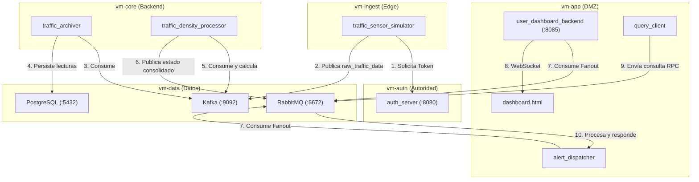

# Especificación de Comportamiento Esperado: SmartTraffic Zero Trust

Este documento describe de forma exhaustiva el **comportamiento esperado** del sistema **SmartTraffic Zero Trust**, cubriendo la arquitectura distribuida, el flujo de datos end-to-end, las políticas de seguridad de red, el modelo de dominio en Java y los criterios de validación para la evaluación.

---

## 1. Visión General y Filosofía de Diseño

El sistema simula y procesa el tráfico vehicular de una ciudad bajo un modelo de **Confianza Cero (Zero Trust)**. Ningún componente confía en otro por defecto:
1. **Red hostil:** Cada zona de red (VM) aplica política `DROP` por defecto en `input` y `output` mediante `nftables`.
2. **Identidad explícita:** Toda interacción servicio a servicio (S2S) y contra brokers de mensajería requiere autenticación criptográfica vía **JWT**.
3. **Dominio rico e inmutable:** Los datos de tráfico son validados de forma *Fail-Fast* en objetos inmutables (`record`) y los estados/algoritmos se gestionan con patrones de diseño puros (*State*, *Strategy*, *Observer*), sin anidar lógica condicional en controladores.

---

## 2. Comportamiento por Zona de Seguridad (Infraestructura)

El sistema opera sobre **5 Zonas / Máquinas Virtuales**, cada una con responsabilidades y reglas de red específicas:

### Reglas de Cortafuegos (`nftables` - Default DROP)

| Zona / VM | Tráfico de Entrada (`input`) Permitido | Tráfico de Salida (`output`) Permitido |
| :--- | :--- | :--- |
| **`vm-auth`** | Puerto HTTP Auth únicamente desde las IPs de `vm-ingest`, `vm-core` y `vm-app`. | Paquetes de respuesta establecidos/relacionados hacia esas 3 VMs. |
| **`vm-data`** | • Puerto 9092 (Kafka) solo desde `vm-ingest` y `vm-core`. • Puerto 5672 (RabbitMQ) solo desde `vm-core` y `vm-app`. • Puerto 5432 (Postgres) solo desde `vm-core`. | Tráfico establecido/relacionado hacia los orígenes autorizados. |
| **`vm-ingest`** | Ninguna conexión entrante nueva permitida. | • HTTP Auth hacia `vm-auth`. • Puerto 9092 hacia `vm-data`. |
| **`vm-core`** | Ninguna conexión entrante nueva permitida. | • HTTP Auth hacia `vm-auth`. • Puertos 9092, 5672 y 5432 hacia `vm-data`. |
| **`vm-app`** | • Puerto WebSocket/HTTP del dashboard abierto para clientes externos. | • HTTP Auth hacia `vm-auth`. • Puerto 5672 hacia `vm-data`. |

> [!IMPORTANT]
> Cualquier paquete fuera de esta matriz debe ser descartado silenciosamente (`DROP`). Si un atacante compromete `vm-ingest`, **no** puede acceder a PostgreSQL ni a RabbitMQ ni a `vm-app`.

---

## 3. Flujo de Datos End-to-End (Comportamiento en Ejecución)

### Paso 1: Arranque y Emisión de Identidad (S2S)
* Cada microservicio Spring Boot al iniciar invoca el endpoint `POST /token` de `auth_server` en `vm-auth`, enviando su `client_id` y `client_secret`.
* **Comportamiento esperado:**
  * Si las credenciales son válidas, recibe un JWT firmado con validez temporal (ej. 15 minutos) y roles específicos (`ROLE_INGEST`, `ROLE_PROCESSOR`, `ROLE_ARCHIVER`, `ROLE_APP`).
  * Si el token expira o es inválido, el cliente debe renovarlo automáticamente sin detener el servicio.
  * Intentos de conexión sin token o con firma alterada son rechazados con `401 Unauthorized`.

### Paso 2: Ingesta y Validación Fail-Fast (`traffic_sensor_simulator`)
* Genera eventos aleatorios periódicos (cada 1-3 segundos) para distintas zonas de la ciudad (ej. `ZONE-CENTRO`, `ZONE-NORTE`, `ZONE-SUR`).
* **Comportamiento del modelo de dominio:**
  * Cada lectura se modela en un `record` inmutable con identificador de sensor, timestamp, conteo de vehículos y velocidad promedio.
  * **Fail-Fast:** Si el conteo de vehículos es `< 0` o la velocidad promedio es `< 0.0`, el constructor compacto lanza inmediatamente `IllegalArgumentException`, impidiendo la creación del objeto.
* **Envío a Kafka:**
  * Se conecta al broker Kafka en `vm-data` autenticando mediante `SASL/OAUTHBEARER` con su JWT.
  * Publica el evento serializado en el tópico `raw_traffic_data`.

### Paso 3: Persistencia Inmutable y Auditoría (`traffic_archiver`)
* Se conecta a Kafka con su propio JWT y consume del tópico `raw_traffic_data`.
* **Comportamiento esperado:**
  * Mapea cada lectura a una entidad JPA inmutable (`TrafficReadingEntity`).
  * Persiste la entidad en la base de datos `PostgreSQL` en `vm-data` mediante repositorios desacoplados (DIP).
  * La base de datos acumula el histórico sin permitir mutaciones ni eliminaciones arbitrarias (solo `INSERT` y `SELECT`).

### Paso 4: Procesamiento Reactivo y Transiciones de Estado (`traffic_density_processor`)
* Consume del tópico `raw_traffic_data` de Kafka autenticado con JWT.
* Mantiene en memoria el agregado de dominio `ZoneTrafficAggregate` para cada zona monitoreada.
* **Patrón Strategy (Cálculo de Densidad):**
  * Aplica un algoritmo polimórfico (`DensityCalculationStrategy`) para determinar el índice de saturación vial basado en conteo y velocidad promedio.
* **Patrón State (Transición de Congestión):**
  * La zona transiciona exclusivamente entre tres estados:
    * `DESPEJADA` (Flujo rápido, bajo volumen).
    * `MODERADA` (Volumen medio, velocidad reducida).
    * `CONGESTIONADA` (Volumen crítico, detenciones frecuentes).
  * Las reglas de cambio de estado residen dentro de cada clase de estado, **sin** usar bloques anidados de `if-else` ni `switch`.
* **Salida hacia RabbitMQ:**
  * Se autentica contra RabbitMQ en `vm-data` vía OAuth2.
  * Publica el estado consolidado de la zona en el Exchange Fanout `traffic_updates`.

### Paso 5: Distribución en Tiempo Real y Alertas (`vm-app`)
* **`user_dashboard_backend`:**
  * Se suscribe a una cola vinculada al Exchange Fanout `traffic_updates`.
  * Transmite de inmediato las actualizaciones en formato JSON a través de una conexión WebSocket (`STOMP`) hacia la página web `dashboard.html`.
* **`alert_dispatcher`:**
  * Mantiene una réplica local en memoria del estado de las zonas.
  * **Patrón Observer:** Cuando una zona transiciona al estado `CONGESTIONADA`, los observadores suscritos se activan y generan eventos de alerta crítica de forma desacoplada.

### Paso 6: Consultas Asíncronas de Rutas (`query_client` y `alert_dispatcher`)
* Instancias concurrentes de `query_client` simulan usuarios consultando el estado de un trayecto (ej. "¿Cómo está `ZONE-CENTRO`?").
* **Comportamiento asíncrono (RPC pattern sobre RabbitMQ):**
  1. `query_client` genera una clave de correlación (`correlation_id`) y una cola exclusiva de respuesta temporal (`reply_to`).
  2. Publica la solicitud en la cola `query_traffic_queue`.
  3. `alert_dispatcher` consume la solicitud, consulta su réplica de dominio y publica el diagnóstico hacia el Topic Exchange `query_answers`.
  4. `query_client` recibe la respuesta en su cola privada y correlaciona el ID, completando el ciclo asíncrono.
  5. Si se consulta una zona no registrada, el dominio lanza una excepción controlada (`ZoneNotFoundException`) retornando un mensaje de error estructurado.

---

## 4. Comportamiento de Aislamiento y Pruebas Unitarias (TDD)

Las pruebas unitarias del repositorio deben satisfacer las siguientes condiciones:

1. **Pruebas de Dominio Puro (Sin Frameworks):**
   * Ubicadas en el módulo `smarttraffic-domain`.
   * Estructuradas estrictamente bajo el patrón **AAA** (*Arrange, Act, Assert*).
   * **Cero dependencias:** No inician Spring Boot, no abren puertos de red, no conectan a base de datos.
   * Ejecución ultra rápida (en milisegundos).
   * Verifican:
     * Transiciones correctas del patrón *State* (ej. verificar que `DESPEJADA` pasa a `MODERADA` con el umbral adecuado).
     * Lanzamiento de excepciones ante valores inválidos en los constructores de los `record`.
     * Correcto cálculo del patrón *Strategy*.

2. **Pruebas de Servicios con Mocks (Mockito):**
   * Uso de `@ExtendWith(MockitoExtension.class)`.
   * Aislamiento de repositorios JPA y productores de Kafka/RabbitMQ mediante `@Mock`.
   * Verificación de contratos mediante `verify(..., times(1))`, certificando que cada lectura recibida desencadena exactamente una persistencia y una emisión.

---

## 5. Gobernanza de Recursos en Contenedores

Cada contenedor en cada VM debe implementar restricciones estrictas de hardware:

* **Límites de CPU y RAM:** Definidos en los archivos Compose locales mediante `deploy.resources.limits`:
  * Microservicios Spring Boot: límite máximo de CPU (ej. `cpus: '0.5'`) y memoria RAM (ej. `memory: 384M` - `512M`).
  * `traffic_sensor_simulator`: cuota reducida (ej. `memory: 256M`).
  * PostgreSQL: `memory: 512M`.
* **Ergonomía de la JVM:**
  * Variables de entorno: `JAVA_OPTS="-XX:+UseContainerSupport -XX:MaxRAMPercentage=75.0 -XX:+ExitOnOutOfMemoryError"`.
  * La JVM debe detectar automáticamente el límite del cgroup del contenedor y no el total de la VM anfitriona.
* **Seguridad de Contenedores:**
  * Las imágenes de runtime corren bajo el usuario sin privilegios `appuser:appgroup` (UID/GID no root).

---

## 6. Criterios de Aceptación para la Evaluación (15 Minutos)

Para considerar el comportamiento del sistema 100% aprobado en la sustentación:

- [ ] **Despliegue IaaC:** Las 5 VMs arrancan de forma reproducible (`vagrant up` o scripts Ansible).
- [ ] **Aislamiento Zero Trust comprobable:** Demostración con `curl` o `netcat` de que desde `vm-ingest` o `vm-app` es imposible conectarse al puerto 5432 (Postgres) o que el tráfico no autorizado es bloqueado por `nftables`.
- [ ] **Flujo End-to-End continuo:**
  1. El sensor genera lecturas aleatorias.
  2. Kafka recibe los mensajes y el archiver los guarda en PostgreSQL.
  3. El procesador calcula la densidad y transiciona de estado.
  4. RabbitMQ distribuye las actualizaciones.
  5. `dashboard.html` muestra en tiempo real las zonas y sus estados vía WebSocket.
- [ ] **Consultas asíncronas:** Ejecución concurrente de `query_client` recibiendo respuestas correlacionadas.
- [ ] **Defensa de arquitectura:** Explicación justificada de:
  * Por qué Kafka para ingesta y RabbitMQ para distribución/consultas.
  * Por qué el modelo de dominio no es anémico y cómo se protegieron las invariantes.
  * Justificación de las reglas de cortafuegos y el flujo de tokens JWT.
